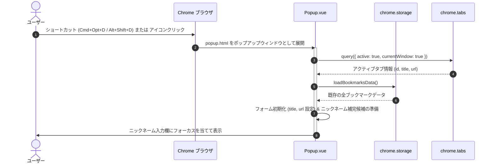
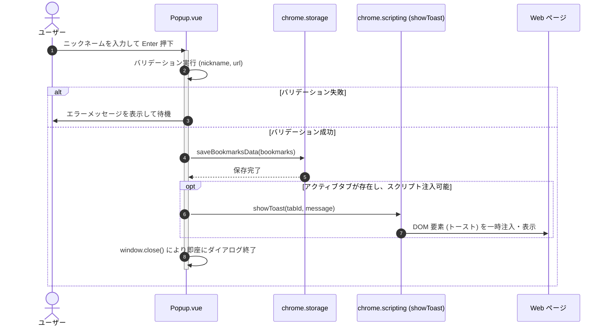

# インターフェース契約: UI 操作とライフサイクル (UI Actions & Lifecycle Contract)

**機能ブランチ**: `001-shortcut-add-bookmark`
**作成日**: 2026-11-08
**ステータス**: 完了 (Completed)

---

## 1. ポップアップの起動・初期化シーケンス

---

## 2. 保存実行とクローズシーケンス

---

## 3. キーボード操作契約

| キー | 対象要素 | 動作 |
| :--- | :--- | :--- |
| `Enter` | ニックネーム / タイトル / URL / デフォルト値入力欄 | フォーム送信（保存実行）を行い、成功時にポップアップを閉じる。 |
| `Escape` | ポップアップ全体 | ポップアップを直ちに閉じる（Chrome 標準動作 + 必要に応じハンドリング）。 |
| `Tab` / `Shift+Tab` | フォーカス可能要素 | ニックネーム → タイトル → URL → (デフォルト値) → 登録ボタン → ヘッダーボタンの順に巡回。 |
