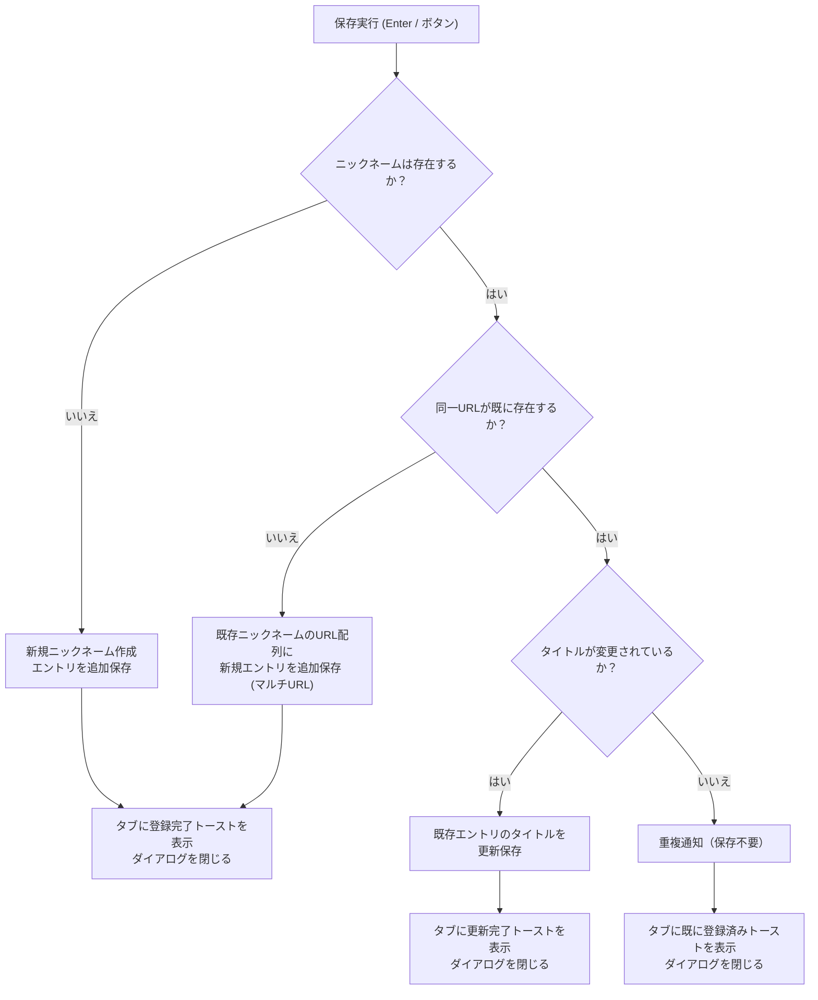

# データモデル仕様 (Data Model Specification)

**機能ブランチ**: `001-shortcut-add-bookmark`
**作成日**: 2026-11-08
**ステータス**: 完了 (Completed)

---

## 1. 永続エンティティ (Persistent Entities)

本機能では、既存の Nickmark データ構造をそのまま使用し、後方互換性を 100% 維持します。

### BookmarkEntry（ブックマークエントリ）
各ブックマークの詳細情報を保持するエンティティ。

```typescript
export interface BookmarkEntry {
  /** 登録対象のURL、またはブックマークレットコード（javascript:...） */
  url: string;
  /** ブックマークの表示タイトル */
  title: string;
  /** 指数減衰スコア（初期値: 1.0） */
  score: number;
  /** 最終使用日時（エポックミリ秒） */
  last_used_at: number;
  /** 作成日時（エポックミリ秒） */
  created_at: number;
  /** ピン留めフラグ（任意） */
  is_pinned?: boolean;
  /** 動的URL（%s）使用時の引数省略時デフォルト値（任意） */
  default_value?: string;
}
```

### NickmarkData（ブックマークデータ全体）
ニックネームをキーとした辞書形式。

```typescript
export interface NickmarkData {
  bookmarks: Record<string, BookmarkEntry[]>;
}
```

---

## 2. ポップアップ UI 状態モデル (Popup State Model)

登録ダイアログ（`src/Popup.vue`）が内部で管理するリアクティブなフォーム状態。

```typescript
export interface PopupFormState {
  /** ニックネーム（ユーザー入力） */
  nickname: string;
  /** タイトル（初期値: アクティブタブのタイトル） */
  title: string;
  /** URL（初期値: アクティブタブのURL） */
  url: string;
  /** 動的URLのデフォルト値（URLに %s が含まれる場合のみ表示） */
  defaultValue: string;
  /** ニックネームの補完サジェスト候補リスト */
  filteredNicknames: string[];
  /** 処理中フラグ（二重送信防止用） */
  isSubmitting: boolean;
  /** 現在のアクティブタブID（通知用） */
  activeTabId: number | null;
  /** エラーメッセージ表示用（バリデーション用） */
  errorMessage: string | null;
}
```

---

## 3. バリデーションルール (Validation Rules)

| フィールド | ルール | エラー時挙動 |
| :--- | :--- | :--- |
| `nickname` | 必須。前後の空白を除去して 1 文字以上であること。 | エラーメッセージ表示。フォーカスを戻して送信中断。 |
| `url` | 必須。前後の空白を除去して 1 文字以上であること。 | エラーメッセージ表示。送信中断。 |
| `title` | 任意。未入力の場合は空文字（タブタイトルがあればそれを採用）。 | なし。 |
| `defaultValue` | 任意。URL に `%s` が含まれる場合のみ保存対象。 | なし。 |

---

## 4. 重複登録・更新判定ルール (Duplicate Handling Logic)

登録実行時、入力された `nickname` と `url` に基づいて以下の判定を行う：


