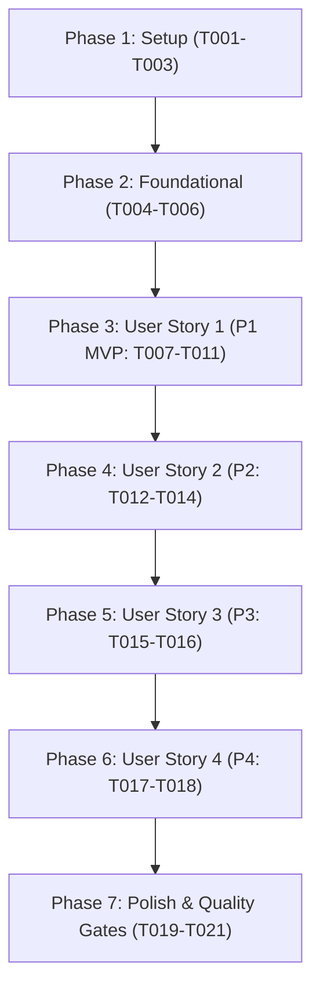

# タスク一覧: ショートカットによるブックマーク登録機能 (Shortcut Bookmark Registration)

**ブランチ**: `001-shortcut-add-bookmark`
**入力**: 設計ドキュメント (`/specs/001-shortcut-add-bookmark/`)
**前提条件**: `plan.md`, `spec.md`, `research.md`, `data-model.md`, `contracts/`, `quickstart.md`, `constitution.md`

## フォーマット: `- [ ] [TaskID] [P?] [Story?] 説明（ファイルパス含む）`

- **[P]**: 並列実行可能タスク（異なるファイル、未完了タスクへの依存なし）
- **[Story]**: ユーザーストーリー識別子（`[US1]`, `[US2]`, `[US3]`, `[US4]`）
- すべてのタスクに対象ファイルパスを明記

---

## Phase 1: Setup (共通インフラストラクチャ)

**目的**: ポップアップ画面のバンドル構成および基本ファイル群の初期化

- [x] T001 Webpack 設定にポップアップ用エントリーポイント（`popup: './src/popup.ts'`）を追加する（`webpack.config.js`）
- [x] T002 [P] ポップアップウィンドウ用の基本 HTML ファイルを作成し、PrimeVue Aura スタイルと `js/popup.js` 読み込みを構成する（`package/popup.html`）
- [x] T003 [P] ポップアップ用のアタッチエントリーポイントを作成し、Vue 3 アプリ起動・PrimeVue・Aura テーマ・ToastService のマウントを設定する（`src/popup.ts`）

---

## Phase 2: Foundational (ブロッキング前提条件)

**目的**: 全ユーザーストーリーの実装に先立ち必須となる Manifest 設定・多言語メッセージ・バックグラウンド共有関数を整備

**⚠️ 重要**: 本フェーズ完了までユーザーストーリーの実装に着手してはならない

- [x] T004 `src/background.ts` 内の `showToast` 関数を `export` 化し、他モジュール（ポップアップ UI）から直接呼び出せるようにリファクタリングする（`src/background.ts`）
- [x] T005 [P] 日本語および英語のメッセージリソースに、ポップアップ関連の翻訳キー（`commandRegisterBookmark`, `popupTitle`, `saveBtn`, `closeBtn`, `openOptionsTooltip`, `openPreferencesTooltip`）を追加する（`package/_locales/ja/messages.json`, `package/_locales/en/messages.json`）
- [x] T006 `package/manifest.json` の `action` に `default_popup: "popup.html"` を設定し、`commands` に `_execute_action`（Mac: `Command+Shift+D`, default: `Alt+Shift+D`）を追加する（`package/manifest.json`）

**チェックポイント**: 基盤整備完了。各ユーザーストーリーの実装に進むことが可能。

---

## Phase 3: User Story 1 - ショートカットからの迅速なブックマーク登録 (Priority: P1) 🎯 MVP

**ゴール**: ユーザーがショートカットキー（Mac: `Command + Shift + D`, Win/Linux: `Alt + Shift + D`）を押すと登録ダイアログが開き、アクティブタブ情報が自動入力された状態でニックネームを入力して Enter を押すだけで即座にブックマークが登録され、トースト通知が表示されてダイアログが閉じる。

**独立テスト検証**: 任意のWebページでショートカットキーを押し、ダイアログが開いてニックネームを入力して Enter を押すと、ダイアログが閉じてWebページ上に登録完了トーストが表示され、アドレスバーからそのニックネームでアクセスできることを確認。

### 実装タスク (Implementation for User Story 1)

- [x] T007 [US1] PrimeVue コンポーネント（Card, InputText, Button）を用いた登録フォーム（ニックネーム・タイトル・URL）の基本 UI レイアウトを実装する（`src/Popup.vue`）
- [x] T008 [US1] コンポーネントマウント時に `chrome.tabs.query({ active: true, currentWindow: true })` で現在のアクティブタブ情報を取得し、タイトルと URL をフォームに初期設定してニックネーム入力欄に自動フォーカスする処理を実装する（`src/Popup.vue`）
- [x] T009 [US1] 登録実行時のバリデーション処理（制約: `nickname` は必須かつ空白除去後1文字以上、`url` は必須かつ空白除去後1文字以上）と、`saveBookmarksData` によるブックマーク永続化ロジックを実装する（`src/Popup.vue`）
- [x] T010 [US1] 保存完了時にアクティブタブへ `showToast` による登録完了トースト（`'nickname' として登録しました！`）を表示し、`window.close()` でダイアログを自動クローズする処理を実装する（`src/Popup.vue`）
- [x] T011 [US1] ニックネーム入力欄での Enter キー押下による保存実行、および Esc キー押下（または閉じるボタン）によるダイアログ終了のキーボードハンドリングを実装する（`src/Popup.vue`）

**チェックポイント**: この時点で User Story 1 (MVP) が単独で完全に動作し、テスト可能であること。

---

## Phase 4: User Story 2 - 既存ニックネームの補完と複数URL登録 (Priority: P2)

**ゴール**: ニックネーム入力中に既存ニックネームの補完候補が表示され、既存ニックネームを選択して同一ニックネームに複数のURLをグループ登録できる。

**独立テスト検証**: 登録ダイアログで既存ニックネームを入力した際に候補リストが表示され、既存ニックネームを選択して保存すると、同一ニックネームに複数のURLが保存され、アドレスバーから選択起動できることを確認。

### 実装タスク (Implementation for User Story 2)

- [x] T012 [US2] ポップアップ初期化時に `loadBookmarksData()` で既存の全ブックマークを読み込み、入力テキストに基づいて前方一致・部分一致するニックネーム候補リスト（`filteredNicknames`）をリアルタイム生成する検索ロジックを実装する（`src/Popup.vue`）
- [x] T013 [US2] ニックネーム入力欄に PrimeVue `AutoComplete` コンポーネントを統合し、サジェスト表示・矢印キー選択・Enter確定ができるよう UI を更新する（`src/Popup.vue`）
- [x] T014 [US2] 重複登録ハンドリング（同一ニックネームに新規URL追加、同一ニックネームかつ同一URLでタイトル変更時はタイトル更新、完全重複時は重複案内通知）を実装する（`src/Popup.vue`）

**チェックポイント**: User Story 1 と User Story 2 の双方が独立して正常に動作すること。

---

## Phase 5: User Story 3 - ツールバーアイコンからのダイアログ起動と管理画面への導線 (Priority: P3)

**ゴール**: ツールバーの拡張機能アイコンクリック時にも同ダイアログが表示され、ヘッダーのアイコンボタンからブックマーク一覧画面および設定画面へワンクリックで遷移できる。

**独立テスト検証**: 拡張機能アイコンをクリックしてダイアログが開き、ヘッダーの「一覧画面」アイコンをクリックすると新しいタブで一覧画面（`list.html`）が開き、「設定」アイコンをクリックすると設定画面（`preferences.html`）が開くことを確認。

### 実装タスク (Implementation for User Story 3)

- [x] T015 [US3] ポップアップのヘッダー右側に「一覧画面を開く」アイコンボタン（`pi pi-list`）および「設定」アイコンボタン（`pi pi-cog`）を配置し、ツールチップとアクセシビリティラベルを設定する（`src/Popup.vue`）
- [x] T016 [US3] ヘッダーアイコンボタンのクリック時に `chrome.runtime.openOptionsPage()` および `chrome.tabs.create({ url: chrome.runtime.getURL('preferences.html') })` を呼び出し、ポップアップを閉じる遷移処理を実装する（`src/Popup.vue`）

**チェックポイント**: アイコンクリック起動および管理画面・設定画面への導線が正常に動作すること。

---

## Phase 6: User Story 4 - 動的URL（%s）のデフォルト値入力 (Priority: P4)

**ゴール**: ユーザーがURL入力欄に `%s` を含めた場合、引数省略時のデフォルト値入力欄が動的に表示され、デフォルト値とともに保存できる。

**独立テスト検証**: URL入力欄に `%s` を含むURLを入力すると「デフォルト値」欄が表示され、値を設定して保存すると動的URLエントリとして保存されることを確認。

### 実装タスク (Implementation for User Story 4)

- [x] T017 [US4] `isDynamicUrl(url)` を用いて URL 入力欄の変更をリアクティブに監視し、`%s` が含まれる場合のみ「引数省略時のデフォルト値（任意）」入力欄を表示する条件付きレンダリングを実装する（`src/Popup.vue`）
- [x] T018 [US4] 保存処理において、動的URLの場合は入力された `defaultValue`（空白除去）を `BookmarkEntry` の `default_value` フィールドに格納して保存するロジックを実装する（`src/Popup.vue`）

**チェックポイント**: すべてのユーザーストーリー（US1〜US4）が完全に機能すること。

---

## Phase 7: Polish & Cross-Cutting Concerns (仕上げと品質ゲート)

**目的**: ビルド検証、ドキュメントの同期、実機シナリオテストによる品質保証

- [x] T019 プロジェクト全体のビルド（`npm run build`）を実行し、TypeScript コンパイルエラーがないこと、および `package/js/popup.js` と最新の `package.zip` が正常に出力されることを確認する（`package/js/popup.js`）
- [x] T020 [P] ショートカットキー（`Command+Option+D` / `Alt+Shift+D`）およびポップアップダイアログに関する新仕様を仕様書および README に追記・同期する（`.context/spec.md`, `README.md`）
- [x] T021 `specs/001-shortcut-add-bookmark/quickstart.md` に定義された 4 つの実機検証シナリオ（基本登録、補完・複数登録、ツールバーアイコン遷移、動的URL登録）を実行して品質基準を満たすことを検証する（`specs/001-shortcut-add-bookmark/quickstart.md`）

---

## 依存関係と実行順序 (Dependencies & Execution Order)

### フェーズ間の依存関係

- **Phase 1 (Setup)**: 依存関係なし。直ちに開始可能。
- **Phase 2 (Foundational)**: Phase 1 完了に依存。**全ユーザーストーリーの実装をブロック**。
- **Phase 3〜6 (User Stories)**: Phase 2 完了後に優先度順（P1 → P2 → P3 → P4）で順次実装。各ストーリーは独立して機能・検証可能。
- **Phase 7 (Polish)**: すべてのユーザーストーリー完了後に実行。

---

## 並行実行の機会 (Parallel Opportunities)

- **Phase 1**: `T002`（`package/popup.html`）と `T003`（`src/popup.ts`）は互いに異なるファイルのため並列実行可能。
- **Phase 2**: `T004`（`src/background.ts`）と `T005`（`package/_locales/*`）は並列実行可能。
- **Phase 7**: `T020`（ドキュメント同期）はビルド検証や実機テストと並行して進めることが可能。

---

## 実装戦略 (Implementation Strategy)

### MVP優先アプローチ (User Story 1 を最速で納品)
1. **Phase 1 (Setup)** を完了。
2. **Phase 2 (Foundational)** を完了（基盤整備）。
3. **Phase 3 (User Story 1)** を完了 → **ここで動作確認！**（MVP達成: ショートカットからのブックマーク登録が完全に機能）。
4. 以降、User Story 2（補完）、User Story 3（ヘッダー導線）、User Story 4（動的URL）を順次インクリメンタルに追加。
5. 最後に **Phase 7** でビルド・ドキュメント・実機テストを完了。
