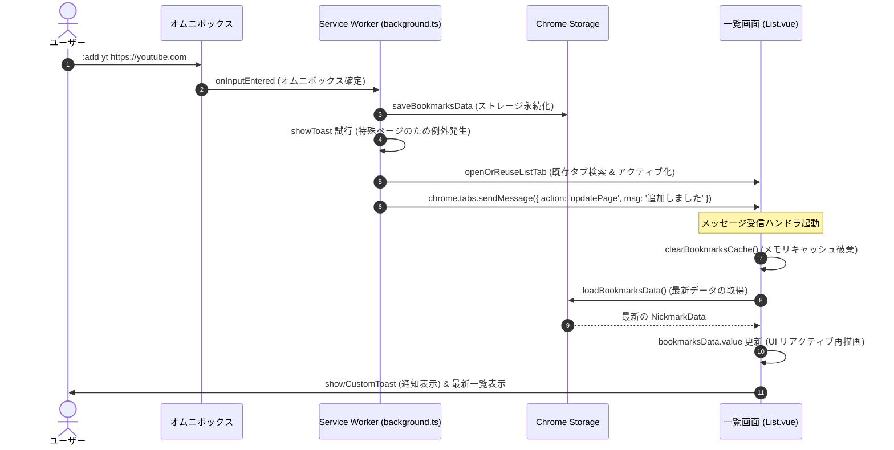

# Data Model & State Lifecycle: ブックマーク一覧タブの自動更新

**Feature Branch**: `004-refresh-list-on-add`  
**Date**: 2026-11-09  
**Related Spec**: [spec.md](./spec.md)

## エンティティ定義

### 1. BookmarkEntry (ブックマークエントリ)
各ブックマークの個別データ構造です（`src/background.ts` で定義）。

| フィールド | 型 | 必須 | 説明 |
|---|---|:---:|---|
| `url` | `string` | ○ | ブックマーク対象の URL（動的 URL の場合は `%s` を含む） |
| `title` | `string` | ○ | ページのタイトルまたは表示名 |
| `is_pinned` | `boolean` | - | ピン留めフラグ（true の場合、候補一覧の上位に固定表示） |
| `created_at` | `number` | - | 登録日時（UNIXミリ秒タイムスタンプ） |
| `last_used_at` | `number` | - | 最終利用日時（UNIXミリ秒タイムスタンプ） |
| `score` | `number` | - | 指数減衰スコア（利用頻度・新しさに基づく計算値） |

### 2. NickmarkData (ブックマーク辞書)
ニックネームをキーとしたブックマークエントリの配列マップです。

```typescript
export type NickmarkData = Record<string, BookmarkEntry[]>;
```

### 3. UpdatePageMessage (一覧画面更新メッセージ)
Service Worker から一覧画面タブへ送信される内部通信ペイロードです。

| フィールド | 型 | 必須 | 説明 |
|---|---|:---:|---|
| `action` | `'updatePage'` | ○ | メッセージの識別子 |
| `msg` | `string` | - | 画面上にトースト通知として表示するメッセージ |
| `url` | `string` | - | 新規追加ダイアログ等の URL 欄に事前入力する値 |
| `title` | `string` | - | 新規追加ダイアログ等の Title 欄に事前入力する値 |

---

## 状態ライフサイクルと同期フロー



---

## 状態遷移の保証

1. **メモリキャッシュ整合性の保証**:
   - `loadBookmarksData()` 呼び出し前に `clearBookmarksCache()` を実行することにより、Service Worker 以外の別コンテキスト（`list.html`）内に残る古いメモリキャッシュが確実にバイパスされ、最新のストレージデータが読み込まれます。
2. **UI リアクティビティ**:
   - `List.vue` 内部の `bookmarksData` は Vue の `ref<Record<string, BookmarkEntry[]>>` で管理されているため、新データ代入時に Vue の依存性追跡により `DataTable` などの UI コンポーネントが自動的・滑らかに再描画されます。
